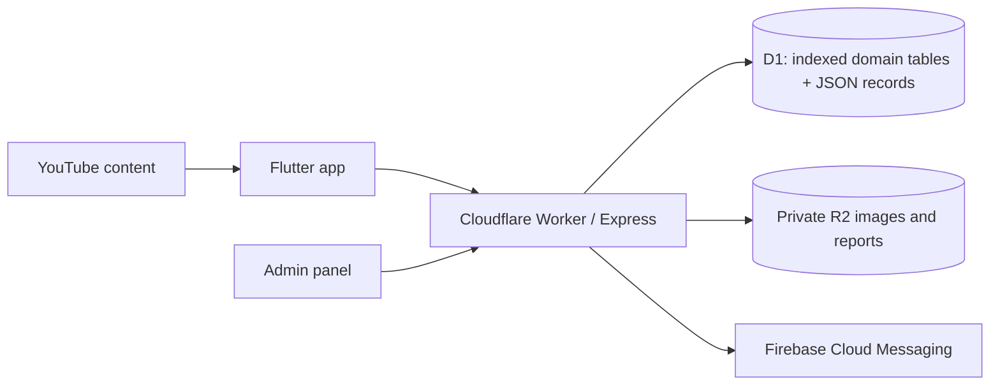

# Data architecture

## Runtime and storage

The API is a Cloudflare Worker that runs the existing Express route/controller/use-case structure. Runtime bindings provide D1 (`DB`) and R2 (`MEDIA_BUCKET`). KV is provisioned for a future explicitly public, short-lived configuration use case; it is not used for patient or admin data.

## D1 model

The schema is in `migrations/0001_initial_schema.sql`. Each domain has its own table and stable text ID. A JSON payload preserves nested domain structures while indexed columns support identity lookups, ownership checks, sorting, and pagination. Unique indexes enforce provider-event IDs, appointment slot rules, device tokens, and other uniqueness constraints. SQL values are always bound parameters.

Domains include users and sessions; OTPs; hair tests and drafts; treatments and reports; appointments and closed dates; patient activity, care events, and progress; products, categories, carts, addresses, coupons, orders, and inventory ledger/operations; payments and webhook events; reviews; notification campaigns, device tokens and inbox; videos/content; audit events; feature flags; releases; and admin accounts.

Use direct SQL for hot aggregate and concurrency-sensitive paths. Inventory release uses D1 batch operations with idempotency records. Avoid loading entire tables for counts, dashboards, or transactional stock updates.

## Media and privacy

- R2 contains images and private clinical documents only. Video uploads are disabled; video content is a YouTube URL.
- R2 buckets remain private. Public catalog images pass through the API. Clinical images/reports require an authenticated owner/admin request and a short-lived signed API URL.
- Store object keys and metadata in D1, never file bytes. Validate actual file type, size, and purpose before writing objects.
- Do not cache patient or admin API responses in Cloudflare Cache/KV. Do not enable image optimization for the admin panel.

## Local and environment setup

- Wrangler local bindings isolate local D1/R2/KV state. Apply the SQL migration before starting the local Worker.
- Dev and staging resources are separate; staging uses Razorpay test credentials and an explicit Shiprocket simulator. Shiprocket's documented external API is live, so staging must never receive its live credentials.
- Production resource bindings/secrets are configured separately and remain gated. Do not copy development data or credentials into production.
- See `CLOUDFLARE_MIGRATION.md` for CI/CD, environment bindings, and required secrets.
